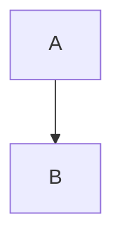

## GFMBOUNDARY0000

| paragraph |
| header |
| --- |
| row |


## GFMBOUNDARY0001

これは**重要。**です

## GFMBOUNDARY0002

これは**重要**です。

## GFMBOUNDARY0003

| Head |
| --- |
| C \\| Charlie |
| E \\\\| Echo |


## GFMBOUNDARY0004

[ www.example.com

[ https://example.com

## GFMBOUNDARY0005

a www. b

## GFMBOUNDARY0006

WWW.COMMONMARK.ORG

## GFMBOUNDARY0007

Some calls.[^C][^D]

[^ C]: first

[^D ]: second

## GFMBOUNDARY0010

Call.[^a\]b].

[^a\]b]: y

## GFMBOUNDARY0012

[^]

## GFMBOUNDARY0013

[^a
b]: # c

xxx[^a
b].

## GFMBOUNDARY0014

- [ ] `[x]`

## GFMBOUNDARY0015

a~~***a***~~a

## GFMBOUNDARY0016

~one~ and ~~two~~

## GFMBOUNDARY0017

**outer **inner** outer**

## GFMBOUNDARY0018

| A |
| --- |
| kept | DROPPED |

## GFMBOUNDARY0019

| A |
| --- |
| `a\|b` |

## GFMBOUNDARY0020

| A |
| --- |
| `a|b` |

## GFMBOUNDARY0021

a
b

## GFMBOUNDARY0022

`a
b`

## GFMBOUNDARY0024

$a <b > c$

## GFMBOUNDARY0025

$[(a+b)c](d+e)$

## GFMBOUNDARY0026

${a}_b c_{d}$

## GFMBOUNDARY0027

$\{a\,b\}$

## GFMBOUNDARY0028

$\begin{pmatrix}a & b\\ c & d\end{pmatrix}$

## GFMBOUNDARY0029

$`a+%
b`$

## GFMBOUNDARY0030

$`
\left%
(a+b\right)
`$

## GFMBOUNDARY0031

$`\{a\,b\}`$

## GFMBOUNDARY0032

```math
a+%
b
```

## GFMBOUNDARY0035

\(x\) and \[y\]

## GFMBOUNDARY0036

<details>
<summary>More</summary>

Content

</details>

## GFMBOUNDARY0037



## GFMBOUNDARY0038

```mermaid
this is not mermaid
```

## GFMBOUNDARY0039

```geojson
{"type":"FeatureCollection","features":[]}
```

## GFMBOUNDARY0040

```topojson
{"type":"Topology","objects":{},"arcs":[]}
```

## GFMBOUNDARY0041

```stl
solid empty
endsolid empty
```

## GFMBOUNDARY0042

```text
$x$ <b> **bold**
```

## GFMBOUNDARY0043

> [!NOTE]
> Message.

## GFMBOUNDARY0044

> [!TIP]
> Message.

## GFMBOUNDARY0045

> [!IMPORTANT]
> Message.

## GFMBOUNDARY0046

> [!WARNING]
> Message.

## GFMBOUNDARY0047

> [!CAUTION]
> Message.

## GFMBOUNDARY0048

### 01 – Basic example

---

$x = \frac{-b \pm \sqrt{b^2-4ac}}{2a}$

---

$`x = \frac{-b \pm \sqrt{b^2-4ac}}{2a}`$

---

$$
x = \frac{-b \pm \sqrt{b^2-4ac}}{2a}
$$

---

```math
x = \frac{-b \pm \sqrt{b^2-4ac}}{2a}
```

---

## GFMBOUNDARY0049

### 02 – Consecutive math

---

$\alpha$$\beta$

---

$`\alpha`$$`\beta`$

---

$$
\alpha
$$
$$
\beta
$$

---

```math
\alpha
```
```math
\beta
```

---

## GFMBOUNDARY0050

### 03 – Indented math

---

$\alpha$

 $\alpha$

  $\alpha$

   $\alpha$

---

$`\alpha`$

 $`\alpha`$

  $`\alpha`$

   $`\alpha`$

---

$$
\alpha
$$

 $$
 \alpha
 $$

  $$
  \alpha
  $$

   $$
   \alpha
   $$

---

```math
\alpha
```

 ```math
 \alpha
 ```

  ```math
  \alpha
  ```

   ```math
   \alpha
   ```

---

## GFMBOUNDARY0051

### 04 – Math in quote blocks

---

> $\alpha$

---

> $`\alpha`$

---

> $$
> \alpha
> $$

---

> ```math
> \alpha
> ```

---

## GFMBOUNDARY0052

### 05 – Escaped dollar sign

---

$\sqrt{\$4}$, $x = \$$

---

$`\sqrt{\$4}`$, $`x = \$`$

---

$$
\sqrt{\$4}
$$
$$
x = \$
$$

---

```math
\sqrt{\$4}
```
```math
x = \$
```

---

## GFMBOUNDARY0054

### 07 – Math in links

---

[$a$](x)

---

[$`a`$](x)

---

## GFMBOUNDARY0055

### 08 – Escaped symbols in math

---

$\{a\,b\}$

---

$`\{a\,b\}`$

---

$$
\{a\,b\}
$$

---

```math
\{a\,b\}
```

---

## GFMBOUNDARY0056

### 09 – Math in `<details>`

---

<details>

$A = 5$

</details>

---

<details>

$`A = 5`$

</details>

---

<details>

$$
A = 5
$$

</details>

---

<details>

```math
A = 5
```

</details>

---

## GFMBOUNDARY0057

### 10 – `<` without surrounding whitespace

---

$a<b$

---

$`a<b`$

---

$$
a<b
$$

---

```math
a<b
```

---

## GFMBOUNDARY0058

### 11 – Inline math preceeded by non-whitespace

---

$x$ a$x$ 1$x$ -$x$ '$x$ "$x$ ($x$ [$x$ {$x$ /$x$

---

$`x`$ a$`x`$ 1$`x`$ -$`x`$ '$`x`$ "$`x`$ ($`x`$ [$`x`$ {$`x`$ /$`x`$

---

## GFMBOUNDARY0059

### 12 – Inline math succeeded by non-whitespace

---

$x$ $x$a $x$1 $x$- $x$' $x$" $x$) $x$] $x$} $x$/

---

$`x`$ $`x`$a $`x`$1 $`x`$- $`x`$' $`x`$" $`x`$) $`x`$] $`x`$} $`x`$/

---

## GFMBOUNDARY0060

### 13 – Inline math with `%\n`

---

$a+%
b$

---

$`a+%
b`$

---

## GFMBOUNDARY0061

### 14 – Comments before bracket delimiters

---

$
\left%
(a+b\right)
$

---

$`
\left%
(a+b\right)
`$

---

## GFMBOUNDARY0062

### 15 – Small sum/product signs

---

$f(x) = \sum_{i=0}^{n} \prod_{j=0}^{n} a_{i,j}$

---

$`f(x) = \sum_{i=0}^{n} \prod_{j=0}^{n} a_{i,j}`$

---

$$
\frac{\sum_{i=1}^n a_i \prod_{i=1}^n b_i}{2}
$$

---

```math
\frac{\sum_{i=1}^n a_i \prod_{i=1}^n b_i}{2}
```

---

## GFMBOUNDARY0063

### 16 – `\operatorname`

---

$\operatorname*{Min}_{x}$

---

$`\operatorname*{Min}_{x}`$

---

$$
\operatorname*{Min}_{x}
$$

---

```math
\operatorname*{Min}_{x}
```

---

## GFMBOUNDARY0064

### 17 – Inline math in stylized text

---

_Equation $\Omega(69)$ in italic text_

*Equation $\Omega(69)$ in italic text*

**Equation $\Omega(69)$ in bold text**

***Equation $\Omega(69)$ in bold italic text***

---

_Equation $`\Omega(69)`$ in italic text_

*Equation $`\Omega(69)`$ in italic text*

**Equation $`\Omega(69)`$ in bold text**

***Equation $`\Omega(69)`$ in bold italic text***

---

## GFMBOUNDARY0065

### 18 – Inline math at the end of stylized text

---

_$a$ equals $b$_

*$a$ equals $b$*

**$a$ equals $b$**

***$a$ equals $b$***

---

_$`a`$ equals $`b`$_

*$`a`$ equals $`b`$*

**$`a`$ equals $`b`$**

***$`a`$ equals $`b`$***

---

## GFMBOUNDARY0066

### 19 – Dollar in `\text`

---

$\text{$\alpha$}$

---

$`\text{$\alpha$}`$

---

$$
\text{$\alpha$}
$$

---

```math
\text{$\alpha$}
```

---

## GFMBOUNDARY0067

### 20 – Math vs. HTML mix-ups

---

$a <b > c$

<!--Terminate the (false) bold tag-->
</b>

$[(a+b)c](d+e)$

${a}_b c_{d}$

---

$`a <b > c`$

<!--Terminate the (false) bold tag-->
</b>

$`[(a+b)c](d+e)`$

$`{a}_b c_{d}`$

---

$$
a <b > c
$$

<!--Terminate the (false) bold tag-->
</b>

$$
[(a+b)c](d+e)
$$

$$
{a}_b c_{d}
$$

---

```math
a <b > c
```

<!--Terminate the (false) bold tag-->
</b>

```math
[(a+b)c](d+e)
```

```math
{a}_b c_{d}
```

---

## GFMBOUNDARY0068

### 21 – sqrt symbol around fractions

---

$\sqrt{\frac{1}{2}}$

---

$`\sqrt{\frac{1}{2}}`$

---

$$
\sqrt{\frac{1}{2}}
$$

---

```math
\sqrt{\frac{1}{2}}
```

---

## GFMBOUNDARY0069

### 22 – Matrix without line breaks

---

$\begin{pmatrix}a & b\\ c & d\end{pmatrix}$

---

$`\begin{pmatrix}a & b\\ c & d\end{pmatrix}`$

---

$$
\begin{pmatrix}a & b\\ c & d\end{pmatrix}
$$

---

```math
\begin{pmatrix}a & b\\ c & d\end{pmatrix}
```

---

## GFMBOUNDARY0070

### 23 – 50 colors in a block

---

${\color{red}a}{\color{red}a}{\color{red}a}{\color{red}a}{\color{red}a}{\color{red}a}{\color{red}a}{\color{red}a}{\color{red}a}{\color{red}a}{\color{red}a}{\color{red}a}{\color{red}a}{\color{red}a}{\color{red}a}{\color{red}a}{\color{red}a}{\color{red}a}{\color{red}a}{\color{red}a}{\color{red}a}{\color{red}a}{\color{red}a}{\color{red}a}{\color{red}a}{\color{red}a}{\color{red}a}{\color{red}a}{\color{red}a}{\color{red}a}{\color{red}a}{\color{red}a}{\color{red}a}{\color{red}a}{\color{red}a}{\color{red}a}{\color{red}a}{\color{red}a}{\color{red}a}{\color{red}a}{\color{red}a}{\color{red}a}{\color{red}a}{\color{red}a}{\color{red}a}{\color{red}a}{\color{red}a}{\color{red}a}{\color{red}a}{\color{red}a}$

---

$`{\color{red}a}{\color{red}a}{\color{red}a}{\color{red}a}{\color{red}a}{\color{red}a}{\color{red}a}{\color{red}a}{\color{red}a}{\color{red}a}{\color{red}a}{\color{red}a}{\color{red}a}{\color{red}a}{\color{red}a}{\color{red}a}{\color{red}a}{\color{red}a}{\color{red}a}{\color{red}a}{\color{red}a}{\color{red}a}{\color{red}a}{\color{red}a}{\color{red}a}{\color{red}a}{\color{red}a}{\color{red}a}{\color{red}a}{\color{red}a}{\color{red}a}{\color{red}a}{\color{red}a}{\color{red}a}{\color{red}a}{\color{red}a}{\color{red}a}{\color{red}a}{\color{red}a}{\color{red}a}{\color{red}a}{\color{red}a}{\color{red}a}{\color{red}a}{\color{red}a}{\color{red}a}{\color{red}a}{\color{red}a}{\color{red}a}{\color{red}a}`$

---

$$
10:  {\color{red}a}{\color{red}a}{\color{red}a}{\color{red}a}{\color{red}a}{\color{red}a}{\color{red}a}{\color{red}a}{\color{red}a}{\color{red}a}\\
10:  {\color{red}a}{\color{red}a}{\color{red}a}{\color{red}a}{\color{red}a}{\color{red}a}{\color{red}a}{\color{red}a}{\color{red}a}{\color{red}a}\\
10:  {\color{red}a}{\color{red}a}{\color{red}a}{\color{red}a}{\color{red}a}{\color{red}a}{\color{red}a}{\color{red}a}{\color{red}a}{\color{red}a}\\
10:  {\color{red}a}{\color{red}a}{\color{red}a}{\color{red}a}{\color{red}a}{\color{red}a}{\color{red}a}{\color{red}a}{\color{red}a}{\color{red}a}\\
10:  {\color{red}a}{\color{red}a}{\color{red}a}{\color{red}a}{\color{red}a}{\color{red}a}{\color{red}a}{\color{red}a}{\color{red}a}{\color{red}a}
$$

---

```math
10:  {\color{red}a}{\color{red}a}{\color{red}a}{\color{red}a}{\color{red}a}{\color{red}a}{\color{red}a}{\color{red}a}{\color{red}a}{\color{red}a}\\
10:  {\color{red}a}{\color{red}a}{\color{red}a}{\color{red}a}{\color{red}a}{\color{red}a}{\color{red}a}{\color{red}a}{\color{red}a}{\color{red}a}\\
10:  {\color{red}a}{\color{red}a}{\color{red}a}{\color{red}a}{\color{red}a}{\color{red}a}{\color{red}a}{\color{red}a}{\color{red}a}{\color{red}a}\\
10:  {\color{red}a}{\color{red}a}{\color{red}a}{\color{red}a}{\color{red}a}{\color{red}a}{\color{red}a}{\color{red}a}{\color{red}a}{\color{red}a}\\
10:  {\color{red}a}{\color{red}a}{\color{red}a}{\color{red}a}{\color{red}a}{\color{red}a}{\color{red}a}{\color{red}a}{\color{red}a}{\color{red}a}
```

---

## GFMBOUNDARY0071

### 24 – 100 bracketed exponents or subscripts

---

$a^{1} a^{2} a^{3} a^{4} a^{5} a^{6} a^{7} a^{8} a^{9} a^{10}a^{1} a^{2} a^{3} a^{4} a^{5} a^{6} a^{7} a^{8} a^{9} a^{10}a^{1} a^{2} a^{3} a^{4} a^{5} a^{6} a^{7} a^{8} a^{9} a^{10}a^{1} a^{2} a^{3} a^{4} a^{5} a^{6} a^{7} a^{8} a^{9} a^{10}a^{1} a^{2} a^{3} a^{4} a^{5} a^{6} a^{7} a^{8} a^{9} a^{10}a^{1} a^{2} a^{3} a^{4} a^{5} a^{6} a^{7} a^{8} a^{9} a^{10}a^{1} a^{2} a^{3} a^{4} a^{5} a^{6} a^{7} a^{8} a^{9} a^{10}a^{1} a^{2} a^{3} a^{4} a^{5} a^{6} a^{7} a^{8} a^{9} a^{10}a^{1} a^{2} a^{3} a^{4} a^{5} a^{6} a^{7} a^{8} a^{9} a^{10}a^{1} a^{2} a^{3} a^{4} a^{5} a^{6} a^{7} a^{8} a^{9} a^{10}$

---

$`a^{1} a^{2} a^{3} a^{4} a^{5} a^{6} a^{7} a^{8} a^{9} a^{10}a^{1} a^{2} a^{3} a^{4} a^{5} a^{6} a^{7} a^{8} a^{9} a^{10}a^{1} a^{2} a^{3} a^{4} a^{5} a^{6} a^{7} a^{8} a^{9} a^{10}a^{1} a^{2} a^{3} a^{4} a^{5} a^{6} a^{7} a^{8} a^{9} a^{10}a^{1} a^{2} a^{3} a^{4} a^{5} a^{6} a^{7} a^{8} a^{9} a^{10}a^{1} a^{2} a^{3} a^{4} a^{5} a^{6} a^{7} a^{8} a^{9} a^{10}a^{1} a^{2} a^{3} a^{4} a^{5} a^{6} a^{7} a^{8} a^{9} a^{10}a^{1} a^{2} a^{3} a^{4} a^{5} a^{6} a^{7} a^{8} a^{9} a^{10}a^{1} a^{2} a^{3} a^{4} a^{5} a^{6} a^{7} a^{8} a^{9} a^{10}a^{1} a^{2} a^{3} a^{4} a^{5} a^{6} a^{7} a^{8} a^{9} a^{10}`$

---

$$
a^{1} a^{2} a^{3} a^{4} a^{5} a^{6} a^{7} a^{8} a^{9} a^{10}\\
a^{1} a^{2} a^{3} a^{4} a^{5} a^{6} a^{7} a^{8} a^{9} a^{10}\\
a^{1} a^{2} a^{3} a^{4} a^{5} a^{6} a^{7} a^{8} a^{9} a^{10}\\
a^{1} a^{2} a^{3} a^{4} a^{5} a^{6} a^{7} a^{8} a^{9} a^{10}\\
a^{1} a^{2} a^{3} a^{4} a^{5} a^{6} a^{7} a^{8} a^{9} a^{10}\\
a^{1} a^{2} a^{3} a^{4} a^{5} a^{6} a^{7} a^{8} a^{9} a^{10}\\
a^{1} a^{2} a^{3} a^{4} a^{5} a^{6} a^{7} a^{8} a^{9} a^{10}\\
a^{1} a^{2} a^{3} a^{4} a^{5} a^{6} a^{7} a^{8} a^{9} a^{10}\\
a^{1} a^{2} a^{3} a^{4} a^{5} a^{6} a^{7} a^{8} a^{9} a^{10}\\
a^{1} a^{2} a^{3} a^{4} a^{5} a^{6} a^{7} a^{8} a^{9} a^{10}
$$

---

```math
a^{1} a^{2} a^{3} a^{4} a^{5} a^{6} a^{7} a^{8} a^{9} a^{10}\\
a^{1} a^{2} a^{3} a^{4} a^{5} a^{6} a^{7} a^{8} a^{9} a^{10}\\
a^{1} a^{2} a^{3} a^{4} a^{5} a^{6} a^{7} a^{8} a^{9} a^{10}\\
a^{1} a^{2} a^{3} a^{4} a^{5} a^{6} a^{7} a^{8} a^{9} a^{10}\\
a^{1} a^{2} a^{3} a^{4} a^{5} a^{6} a^{7} a^{8} a^{9} a^{10}\\
a^{1} a^{2} a^{3} a^{4} a^{5} a^{6} a^{7} a^{8} a^{9} a^{10}\\
a^{1} a^{2} a^{3} a^{4} a^{5} a^{6} a^{7} a^{8} a^{9} a^{10}\\
a^{1} a^{2} a^{3} a^{4} a^{5} a^{6} a^{7} a^{8} a^{9} a^{10}\\
a^{1} a^{2} a^{3} a^{4} a^{5} a^{6} a^{7} a^{8} a^{9} a^{10}\\
a^{1} a^{2} a^{3} a^{4} a^{5} a^{6} a^{7} a^{8} a^{9} a^{10}
```

---

## GFMBOUNDARY0072

これは**重要。**です

## GFMBOUNDARY0073

これは**重要**です。

## GFMBOUNDARY0074

- [ ] `[x]`

## GFMBOUNDARY0075

- [ ] Explain the marker separately.

```text
[x]
```

## GFMBOUNDARY0076

[ https://example.com

## GFMBOUNDARY0077

[Example](https://example.com)

## GFMBOUNDARY0078

WWW.COMMONMARK.ORG

## GFMBOUNDARY0079

[CommonMark](https://www.commonmark.org)

## GFMBOUNDARY0080

a www. b

## GFMBOUNDARY0081

a `www.` b

## GFMBOUNDARY0082

Text[^alpha]

[^ alpha]: Note.

## GFMBOUNDARY0084

[^]

## GFMBOUNDARY0085


## GFMBOUNDARY0086

[^a
b]: # c

xxx[^a
b].

## GFMBOUNDARY0090

a~~***a***~~a

## GFMBOUNDARY0091

a ~~old~~ a

## GFMBOUNDARY0092

$\{a\,b\}$

## GFMBOUNDARY0093

$`\{a\,b\}`$

## GFMBOUNDARY0094

$[(a+b)c](d+e)$

## GFMBOUNDARY0095

$`[(a+b)c](d+e)`$

## GFMBOUNDARY0096

$a <b > c$

## GFMBOUNDARY0097

$`a \lt b \gt c`$

## GFMBOUNDARY0098

$`a <b > c`$

## GFMBOUNDARY0099

$`a+%
b`$

## GFMBOUNDARY0100

```math
a+%
b
```

## GFMBOUNDARY0053

### 06 – Math in footnotes

---

[^a]

[^a]: Lorem $a$

---

[^a]

[^a]: Lorem $`a`$

---