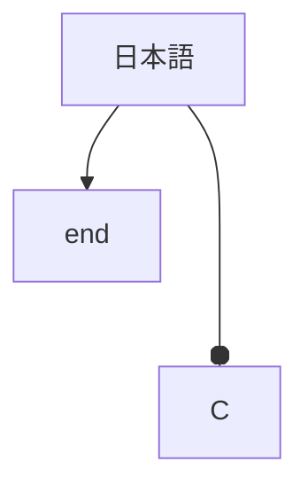

## AUDITBOUNDARY-alerts-five

> [!NOTE]
> Message.

> [!TIP]
> Message.

> [!IMPORTANT]
> Message.

> [!WARNING]
> Message.

> [!CAUTION]
> Message.

## AUDITBOUNDARY-alerts-invalid-nested

> [!UNKNOWN]
> Message.

> > [!NOTE]
> > Nested.

## AUDITBOUNDARY-mermaid-source



```mermaid
not a diagram
```

## AUDITBOUNDARY-data-widgets

```geojson
{"type":"FeatureCollection","features":[]}
```

```topojson
invalid
```

```stl
solid a
endsolid a
```

## AUDITBOUNDARY-literal-source

`$x$` and `<script>`

```text
$`x`$
<details>
flowchart TD
```