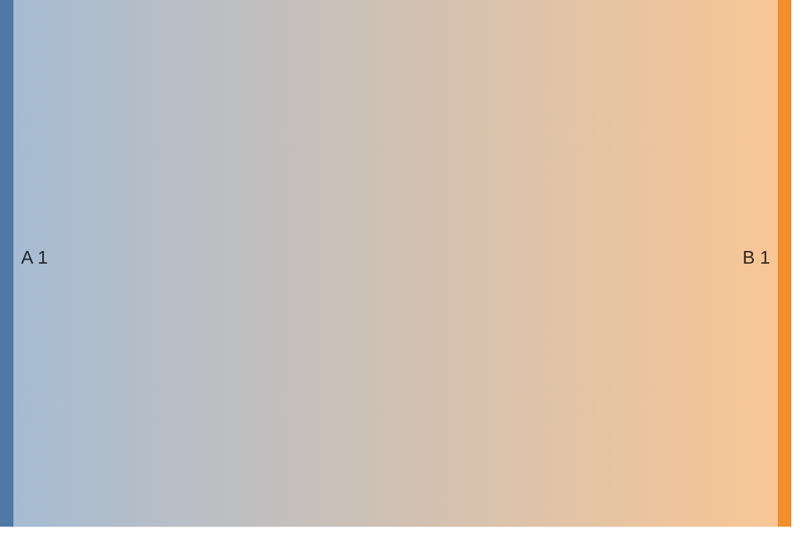
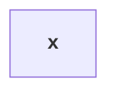
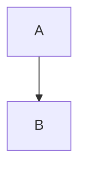

# Deliberately bad GFM rule fixture

This document violates every automatic authoring rule in RULES.md.

## ALERT-001

> [!DANGER]
> message

## AUTO-001

www.example.com and me@example.com

## BLOCK-001

# Deliberately repeated title

# Second document title

## BLOCK-002

- item x
continuation at zero

## CODE-001

````markdown
`````HTML
<script>alert(1)</script>
```
````

## CODE-002

`code with ` embedded backtick

## DETAILS-001

<details><summary>*em*</summary>

text

## DETAILS-002

<details><summary>x</summary>

$y$

## EXT-001

==highlight== [[wiki]] ::: warning

## FOOT-001

[^Bad ID]

[^Bad ID]: note

## FOOT-002

[text[^a]](https://example.com)

[^a]: note

[^]

## FOOT-003

Text[^a]

[^a]: $x$

## HTML-001

<script>alert(1)</script>

<iframe srcdoc="x"></iframe>


<a href="javascript:alert(1)">x</a>

## LINK-001

[ www.example.com and mail me@example.com


## MATH-001

\(x\) and \[y\]

## MATH-002

$a \{ b \}$

## MATH-003

$a+% b$

## MATH-004

$x$$y$

## MATH-005

*before $x$ after*

[$x$](https://example.com)

<b>$x$</b>

## MATH-006

$\text{$x$}$

## MATH-007

$\\$x$

## MATH-008

$\displaystyle\sum_i x_i$

## MATH-009

$a+a+a+a+a+a+a+a+a+a+a+a+a+a+a+a+a+a+a+a+a+a+a+a+a+a+a+a+a+a+a+a+a+a+a+a+a+a+a+a+a+a+a+a+a+a+a+a+a+a+a+a+a+a+a+a+a+a+a+a+a+a+a+a+a+a+a+a+a+a+a+a+a+a+a+a+a+a+a+a+a+a+a+a+a+a+a+a+a+a+a+a+a+a+a+a+a+a+a+a+a+a+a+a+a+a+a+a+a+a+a+a+a+a+a+a+a+a+a+a+a+a+a+a+a+a+a+a+a+a+a+a+a+a+a+a+a+a+a+a+a+a+a+a+a+a+a+a+a+a+a+a+a+a+a+a+a+a+a+a+a+a+a+a+a+a+a+a+a+a+a+a+a+a+a+a+a+a+a+a+a+a+a+a+a+a+a+a+a+a+a+a+a+a+a+a+a+a+a+a+a$

## MERMAID-001

```Mermaid
flowchart TD
A-->B
```

## MERMAID-002



## MERMAID-003

```mermaid
flowchart TD
end-->A
```

## MERMAID-004



## MERMAID-005



## STRIKE-001

~single~ and ~~~~long~~~~

## STRIKE-002

a~~***nested***~~a

## TABLE-001

| a | b |
| --- | --- |
| 1 |
| 1 | 2 | 3 |

## TABLE-002

| a |
| --- |
| - list item |

## TABLE-003

| A |
| --- |
| `a|b` |

## TABLE-004

| A |
| --- |
| $a | b$ |

## TASK-001

-[ ] missing space

## TASK-002

- [x] [ ] extra marker

## TEXT-001

**outer **inner** outer**

## TEXT-002

これは**強調です。**です

## WIDGET-001

```stl
not valid stl
```
