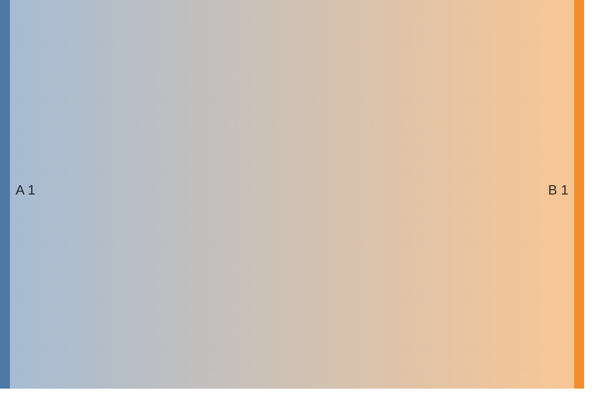
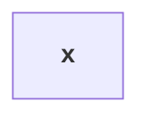
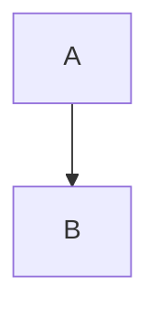
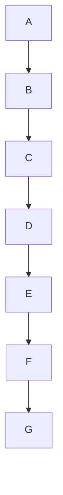

# Deliberately bad GFM style guide document

This document violates every authoring rule in GFM_STYLEGUIDE.md.

## ALERT-001

> [!DANGER]
> message

## ALERT-002

profile: portable-gfm

> [!NOTE]
> use plain text instead of an alert

## AUTO-001

www.example.com and me@example.com

## BLOCK-001

# Deliberately repeated title

# Second document title

## BLOCK-002

- item x
continuation at zero

## BLOCK-003

Violates BLOCK-003: policy is ignored or the unsafe form is used.

## CODE-001

````markdown
`````HTML
<script>alert(1)</script>
```
````

## CODE-002

`code with ` embedded backtick

## COMPAT-001

Math with no declared compatibility profile: $x$

## COMPAT-002

Violates COMPAT-002: policy is ignored or the unsafe form is used.

## COMPAT-003

Violates COMPAT-003: policy is ignored or the unsafe form is used.

## DETAILS-001

<details><summary>*em*</summary>

text

## DETAILS-002

<details><summary>x</summary>

$y$

## EXT-001

==highlight== [[wiki]] ::: warning

## FOOT-001

[^Bad ID]

[^Bad ID]: note

## FOOT-002

[text[^a]](https://example.com)

[^a]: note

[^]

## FOOT-003

Text[^a]

[^a]: $x$

## FOOT-004

Footnote used in a wiki document.

[^wiki]: numbered references are safer here.

## HTML-001

<script>alert(1)</script>

<iframe srcdoc="x"></iframe>


<a href="javascript:alert(1)">x</a>

## LINK-001

[ www.example.com and mail me@example.com

## LINK-002

[relative](../missing.md)

## LINK-003

## Same heading

## Same heading

## MATH-001

$x$

## MATH-002

$x$

$$x$$

## MATH-003

\(x\) and \[y\]

## MATH-004

$a \{ b \}$

## MATH-005

$a+% b$

## MATH-006

$x$$y$

## MATH-007

*before $x$ after*

[$x$](https://example.com)

<b>$x$</b>

## MATH-008

$\text{$x$}$

## MATH-009

$\\$x$

## MATH-010

$\displaystyle\sum_i x_i$

## MATH-011

$a+a+a+a+a+a+a+a+a+a+a+a+a+a+a+a+a+a+a+a+a+a+a+a+a+a+a+a+a+a+a+a+a+a+a+a+a+a+a+a+a+a+a+a+a+a+a+a+a+a+a+a+a+a+a+a+a+a+a+a+a+a+a+a+a+a+a+a+a+a+a+a+a+a+a+a+a+a+a+a+a+a+a+a+a+a+a+a+a+a+a+a+a+a+a+a+a+a+a+a+a+a+a+a+a+a+a+a+a+a+a+a+a+a+a+a+a+a+a+a+a+a+a+a+a+a+a+a+a+a+a+a+a+a+a+a+a+a+a+a+a+a+a+a+a+a+a+a+a+a+a+a+a+a+a+a+a+a+a+a+a+a+a+a+a+a+a+a+a+a+a+a+a+a+a+a+a+a+a+a+a+a+a+a+a+a+a+a+a+a+a+a+a+a+a+a+a+a+a+a+a$

## MEDIA-001


## MERMAID-001

```Mermaid
flowchart TD
A-->B
```

## MERMAID-002

```mermaid
info
```

## MERMAID-003



## MERMAID-004

```mermaid
flowchart TD
end-->A
```

## MERMAID-005



## MERMAID-006



## MERMAID-007



## MERMAID-008


## RENDER-001

Violates RENDER-001: policy is ignored or the unsafe form is used.

## RENDER-002

Violates RENDER-002: policy is ignored or the unsafe form is used.

## RENDER-003

Violates RENDER-003: policy is ignored or the unsafe form is used.

## RENDER-004

Violates RENDER-004: policy is ignored or the unsafe form is used.

## RENDER-005

Violates RENDER-005: policy is ignored or the unsafe form is used.

## RENDER-006

Violates RENDER-006: policy is ignored or the unsafe form is used.

## RENDER-007

Violates RENDER-007: policy is ignored or the unsafe form is used.

## SOCIAL-001

@name #123 :smile: :#ff0000:

## STRIKE-001

~single~ and ~~~~long~~~~

## STRIKE-002

a~~***nested***~~a

## TABLE-001

| a | b |
| --- | --- |
| 1 |
| 1 | 2 | 3 |

## TABLE-002

| a |
| --- |
| - list item |

## TABLE-003

| A |
| --- |
| `a|b` |

## TABLE-004

|   a   |  b |
| --- | --- |
|   1   |  2 |

## TABLE-005

| A |
| --- |
| $a | b$ |

## TASK-001

-[ ] missing space

## TASK-002

- [x] treated as an interactive control

## TASK-003

- [x] [ ] extra marker

## TEXT-001

**outer **inner** outer**

## TEXT-002

これは**強調です。**です

## WIDGET-001

```geojson
not valid json
```

## WIDGET-002

```stl
not valid stl
```

